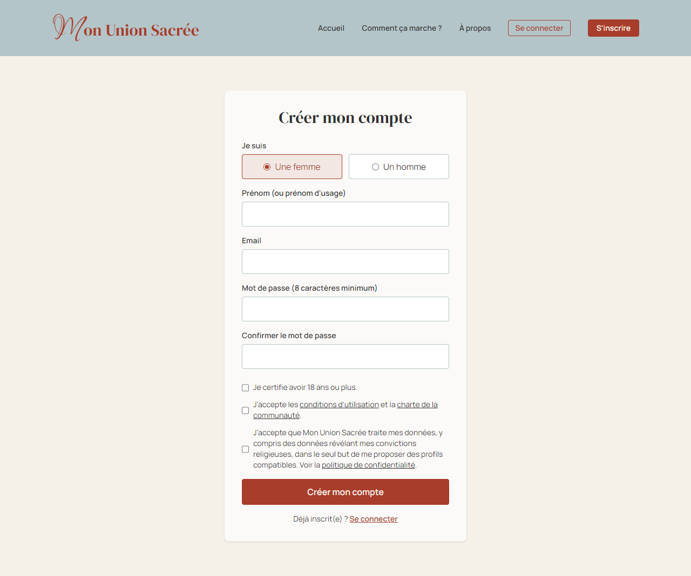
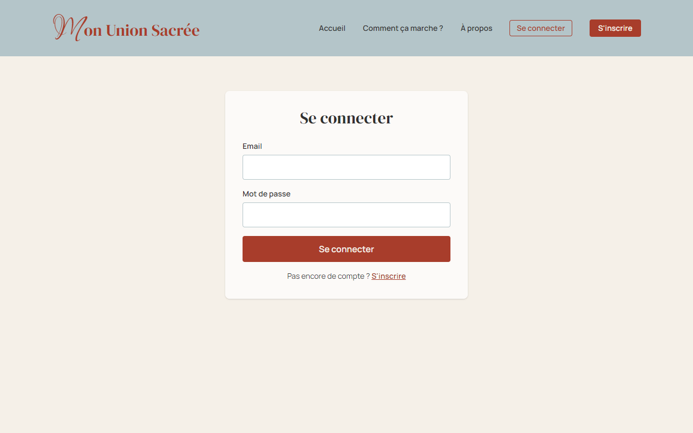

# Mon Union Sacrée

Plateforme matrimoniale musulmane pour **Mayotte et La Réunion** : profils détaillés,
compatibilité, échanges encadrés. Pas une application de dating, une agence matrimoniale accompagnée.

## Aperçu

| Accueil | Mobile |
|---|---|
|  |  |

| Inscription | Connexion |
|---|---|
|  |  |

## Stack

| Rôle | Outil |
|---|---|
| Site + serveur | [Next.js 16](https://nextjs.org) (App Router, Server Actions, Cache Components), TypeScript |
| Style | Tailwind CSS 4 |
| Base de données, comptes, fichiers | [Supabase](https://supabase.com) (PostgreSQL + Row Level Security), région UE |
| Hébergement (prévu) | Vercel |

## Avancement

- [x] Charte graphique (couleurs, polices DM Serif Display / Manrope / Passions Conflict)
- [x] Page d'accueil publique, responsive
- [x] Inscription avec consentements RGPD, confirmation par email, connexion, déconnexion
- [x] Espace membre protégé + tableau de bord
- [x] Profil en 4 étapes (informations, projet, présentation, recherche) avec % de complétion
- [x] Base : profils, critères, consentements, blocages, signalements + règles de sécurité
- [ ] Espace admin (validation des profils, signalements)
- [ ] Découvrir + score de compatibilité
- [ ] Photos
- [ ] Intérêts, matchs, messagerie
- [ ] Pages « Comment ça marche ? », « À propos », CGU, confidentialité, charte
- [ ] Emails en français (Resend) et mise en ligne

## Installation

Prérequis : Node.js 20 ou plus, un projet Supabase.

```bash
npm install
cp .env.example .env        # puis renseigner l'URL et la clé publishable Supabase
npx supabase login
npx supabase link --project-ref <ref-du-projet>
npm run db:push             # applique les migrations sur la base
npm run dev                 # http://localhost:3000
```

Dans Supabase, **Authentication → URL Configuration** :
Site URL `http://localhost:3000`, Redirect URLs `http://localhost:3000/**`.

## Scripts

| Commande | Effet |
|---|---|
| `npm run dev` | Serveur de développement |
| `npm run build` | Build de production |
| `npm run lint` | Vérification du code |
| `npm run db:push` | Envoie les nouvelles migrations sur la base Supabase |
| `npm run db:types` | Régénère les types TypeScript depuis la base |

## Organisation du code

```
src/
  app/
    page.tsx              Accueil
    inscription/          Inscription + « vérifiez votre email »
    connexion/            Connexion
    auth/confirm/         Lien de confirmation reçu par email
    espace/               Espace membre (protégé)
      profil/             Profil en 4 étapes
    actions/              Server Actions (auth, profil)
  components/             Header, logo, champs de formulaire
  lib/
    supabase/             Clients Supabase + types générés
    profil/               Listes de choix, calcul de complétion, lecture du profil
    auth.ts               Membre connecté (contrôle d'accès côté serveur)
  proxy.ts                Rafraîchit la session, protège /espace
supabase/migrations/      Schéma de la base (SQL versionné)
```

Les listes de choix du profil (langues, valeurs, niveaux d'études…) sont toutes dans
[`src/lib/profil/options.ts`](src/lib/profil/options.ts).

## Sécurité des données

- Les règles d'accès sont dans la base (Row Level Security), pas seulement dans le code :
  un membre ne voit que les profils **validés**, **de l'autre sexe**, **sans blocage**.
- Le téléphone (`profile_private`) et les critères ne sont visibles que par le membre lui-même.
- Un membre ne peut pas modifier son statut ni son rôle.
- ⚠️ Les projets Supabase récents ne donnent **aucun droit par défaut** sur les nouvelles tables :
  chaque nouvelle table doit avoir ses `grant` explicites dans sa migration
  (voir `20261127100000_droits_api.sql`).
- Ne jamais mettre la clé **secret** Supabase dans une variable `NEXT_PUBLIC_…` ni dans git.
